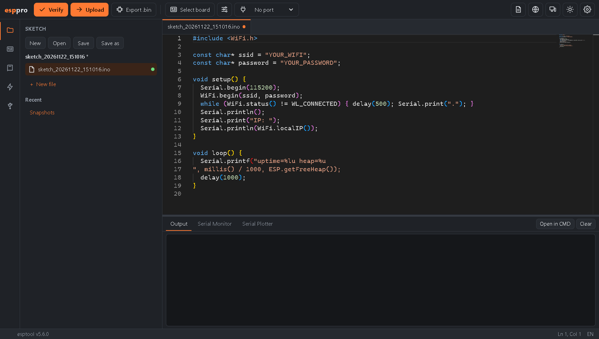
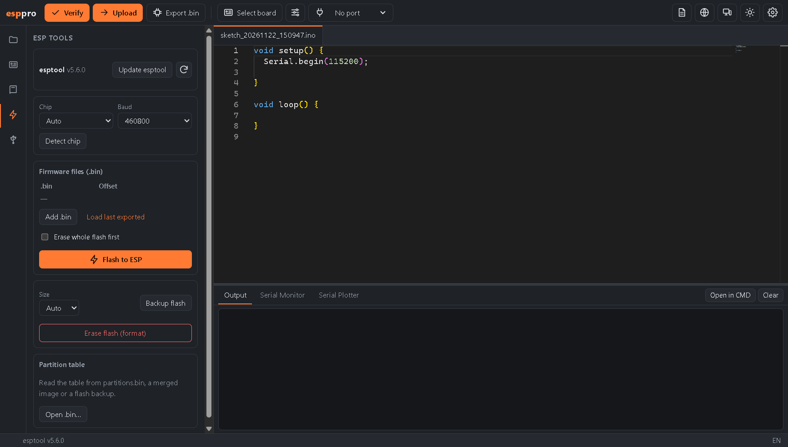

# esppro

بيئة تطوير لـ **Arduino و ESP** على Windows، أخف من Arduino IDE ومع أدوات ESP مدمجة لا تحتاج معها برامج أخرى.



## المزايا

- **محرر Monaco** مع إكمال تلقائي لدوال Arduino و ESP (WiFi، WebServer، ESP، …) ومقاطع جاهزة (Blink، WiFi، HTTP OTA…).
- **تحقق ورفع** بضغطة، و**تصدير ‎.bin** لملفات الفلاش.
- **أدوات ESP** مدمجة عبر esptool: كشف الشريحة تلقائياً، تثبيت ملفات ‎.bin‎ بعناوينها، **نسخة احتياطية** من الفلاش، **مسح/فورمات**، و**عارض جدول الأقسام** من `partitions.bin` أو نسخة احتياطية.
- **رفع OTA عبر الواي فاي** بطريقتين: `espota` العادية، أو **HTTP OTA** عبر صفحة `/update` (لا يعترضه جدار الحماية).
- **الشاشة التسلسلية** (مع طوابع وقت وحفظ سجل) و**راسمة بيانية** (Serial Plotter) تقرأ `name:value`.
- **مدير اللوحات** و**مدير المكتبات** و**فحص التعريفات** (VID/PID) مع شرح الأخطاء الشائعة بالعربية.
- **متصفح مدمج** يفتح صفحة اللوحة على الشبكة مباشرة من الـ IP المكتشف.
- واجهة **عربية/إنجليزية**، فاتح/داكن، نسخ تلقائية للمشروع، ووضع **محمول** (مجلد `esppro-data` بجانب الملف التنفيذي).



## التنزيل

من صفحة [الإصدارات](https://github.com/essa808/esppro/releases/latest):

- `esppro-0.5.0-setup.exe` — مثبّت (عربي/إنجليزي، يختار مجلد التثبيت، اختصار على سطح المكتب).
- `esppro-0.5.0-portable.exe` — نسخة محمولة بملف واحد، تحفظ إعداداتها بجانبها.

`arduino-cli` مضمّن داخل الملفين. التعريفات (CP210x / CH340) تُثبَّت من داخل البرنامج عبر زر «التعريفات».

## التشغيل من المصدر

```bash
npm install
npm start
```

يتطلب Node.js. محرك الترجمة هو `arduino-cli`؛ البرنامج يجده داخل Arduino IDE المثبت، أو ضع `arduino-cli.exe` في مجلد `bin/` بجانب المشروع.

## بناء ملفات التثبيت

```bash
npm run dist
```

ينتج في `dist/` نسختي setup و portable.

## البنية

| المسار | الوظيفة |
|---|---|
| `src/main.js` | العملية الرئيسية: arduino-cli، المنفذ التسلسلي، esptool، التعريفات، الإعدادات |
| `src/preload.js` | الجسر الآمن بين الواجهة والعملية الرئيسية |
| `src/renderer/` | الواجهة: Monaco، اللوحات، النوت بد، المتصفح، الراسمة |
| `src/i18n/` | ملفات اللغات (`ar.json`، `en.json`) — لإضافة لغة انسخ `en.json` وترجمه |
| `src/data/` | روابط اللوحات، جدول التعريفات (VID/PID)، شرح الأخطاء |

### فحص ذاتي للمطوّر

```bash
ESPPRO_SHOT=shot.png npx electron .
```

يحفظ صورة للنافذة ويطبع رسائل الـ console.

## الخصوصية

- لا يتصل البرنامج بأي خدمة خارجية إلا عند تحديث فهارس اللوحات/المكتبات أو تحميل تعريف من موقع الشركة.
- كلمة مرور OTA **لا تُطبع في السجل** ولا تُحفظ على القرص.
- كل الإعدادات والمشاريع تبقى على جهازك؛ لا يوجد خادم ولا قاعدة بيانات.

## الترخيص

MIT — انظر [LICENSE](LICENSE).

يضمّن البرنامج `arduino-cli` التابع لمؤسسة Arduino والمُرَخّص بـ GPL-3.0، مع Electron و Monaco و serialport (MIT). التفاصيل في [build/THIRD-PARTY.txt](build/THIRD-PARTY.txt).

---

### English

esppro is a lightweight Arduino/ESP development environment for Windows: Monaco editor, one-click verify/upload, firmware flashing via esptool (backup, erase, partition viewer), Wi-Fi OTA (espota and HTTP `/update`), serial monitor and plotter, board/library managers, driver check, Arabic/English UI, and a portable mode. MIT licensed; download the ready build from the Releases page. Downloads are standalone — nothing is sent to any server.
